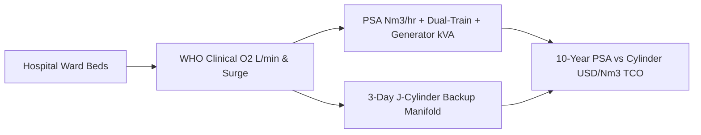

# oxy-plan

[](https://github.com/codesphere-u/oxy-plan/actions/workflows/ci.yml)
[](LICENSE)
[](pyproject.toml)
[](pyproject.toml)

**Zero-dependency WHO medical oxygen infrastructure planner: ward-level L/min demand, PSA plant Nm3/hr & J-cylinder backup manifold sizing, power/generator kVA sizing, and 10-year PSA vs cylinder USD/Nm3 comparator.**

- **Mission Domain:** Healthcare Infrastructure & Biomedical Engineering
- **Stack:** Pure Python 3.11+ (zero runtime third-party dependencies, `mypy --strict`, `ruff`, `pytest`)
- **Maintainer:** Codesphere Innovations (U) Limited (`codesphere-u`)

---

## Problem Solved

District hospitals struggle to size medical oxygen PSA plants, 3-day backup J-cylinder manifolds, and surge-rated backup generators, leading to deadly neonatal and ICU stockouts during power outages.

## Key Features

- WHO ward-level clinical demand model (`NICU/CPAP`, pediatric, adult general, adult ICU, maternity, operating theaters) with seasonal surge multipliers (`plan_hospital_oxygen`).
- Standard PSA skid sizing (`5–100 Nm3/hr`), dual-train ICU redundancy recommendations, compressor running kW & 2.2x-inrush backup generator kVA, and WHO 3-day J-cylinder manifold deficit checks.
- 10-year levelized `USD/Nm3` TCO comparator showing whether a facility should build on-site PSA or rely on cylinders/concentrators.

## Architecture Overview



See [docs/architecture.md](docs/architecture.md) for module-level design details.

## Installation

```bash
git clone https://github.com/codesphere-u/oxy-plan.git
cd oxy-plan
uv sync --extra dev
```

Or install in editable mode with standard `pip`:

```bash
pip install -e ".[dev]"
```

## Quick Start (CLI)

```bash
oxy-plan --nicu 8 --peds 40 --adult 80 --icu 6 --theaters 2 --existing-cylinders 10
```

## Quick Start (Python API)

```python
from oxy_plan import HospitalWardProfile, plan_hospital_oxygen

plan = plan_hospital_oxygen(HospitalWardProfile('RRH-1', nicu_cpap_beds=8, pediatric_beds=40, adult_icu_beds=6))
assert plan.recommended_psa_nm3_hr >= 20 and plan.cost_comparison.recommended_modality == 'on_site_psa'
```

## Testing & Quality Gates

```bash
uv run ruff check src tests
uv run mypy src
uv run pytest -v
```

## Security, Contributing & Roadmap

- **Security:** See [SECURITY.md](SECURITY.md) for responsible disclosure procedures.
- **Contributing:** See [CONTRIBUTING.md](CONTRIBUTING.md) and [CODE_OF_CONDUCT.md](CODE_OF_CONDUCT.md).
- **Changelog & Roadmap:** See [CHANGELOG.md](CHANGELOG.md) and [ROADMAP.md](ROADMAP.md).

## License

MIT License — see [LICENSE](LICENSE).

## Support & Contact

Open an issue on [GitHub Issues](https://github.com/codesphere-u/oxy-plan/issues) or contact `codesphereinnovationz@gmail.com`.
